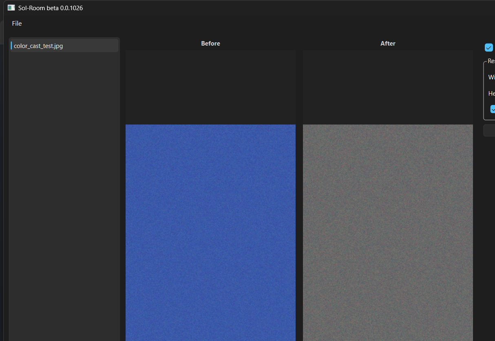

# Sol-Room

**beta 0.0.1026**

A small, fast desktop photo tool — the two things you reach for most in Lightroom, without the rest of Lightroom: **auto white balance** and **high-quality resize**, with a live **before/after** comparison so you can see exactly what changed.



## Features

- 📂 **Folder browsing** — point it at a folder, click through thumbnails
- 🎨 **Auto White Balance** — one-click gray-world color correction, with outlier clipping so blown highlights/deep shadows don't skew the result
- 📐 **High-quality resize** — Lanczos interpolation when upscaling, area-averaging when downscaling, so you always get the sharpest result for the direction you're resizing
- 🔍 **Before / After view** — original and corrected image side by side, updated live as you toggle edits
- 📤 **Export** — save the result at your target dimensions

## How it works

**Auto White Balance** uses the gray-world assumption: average scene color should be neutral gray. It measures each channel's mean (ignoring near-black/near-white outlier pixels so they don't throw off the estimate) and scales R/G/B so their averages match — removing color casts from mixed or unusual lighting.

**Resize** picks its interpolation based on direction: `INTER_LANCZOS4` when enlarging (sharpest for upscaling), `INTER_AREA` when shrinking (avoids moiré/aliasing that sharper filters introduce on downscale).

## Tech stack

- [PySide6](https://doc.qt.io/qtforpython/) — desktop UI
- [OpenCV](https://opencv.org/) — resize interpolation
- [NumPy](https://numpy.org/) — white balance math
- [Pillow](https://python-pillow.org/) — image I/O, EXIF orientation, export

## Getting started

```bash
git clone https://github.com/<your-username>/sol-room.git
cd sol-room

python -m venv .venv
.venv\Scripts\activate      # Windows
# source .venv/bin/activate # macOS/Linux

pip install -r requirements.txt
python main.py
```

## Project structure

```
sol-room/
├── main.py              # entry point
├── core/
│   └── image_ops.py      # auto_white_balance(), resize_image(), resize_to_long_edge()
├── ui/
│   └── main_window.py    # PySide6 window: folder browser, before/after preview, controls
└── requirements.txt
```

## Status

Early beta. Scope is intentionally narrow — this is not trying to replace Lightroom, just nail two editing steps people reach for constantly. More features may land over time (batch export, exposure/contrast, presets).
